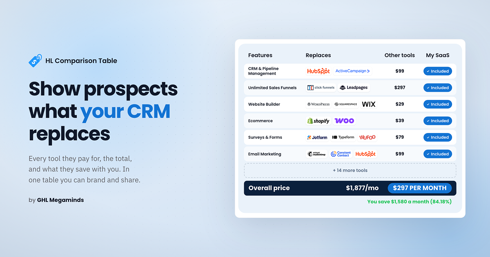

## What is the HL Comparison Table?

The HL Comparison Table is a web tool that lets HighLevel resellers build a branded table showing which tools their platform replaces and how much a prospect saves by comparing the range of tools they use with the reseller’s white-labelled CRM. You pick the features you offer, choose the tools you want to compare against, and set your own price for your own tool. The table does the calculations itself and shows what a prospect would save. When it looks right, you export it as a PNG, copy an embed code, or share a live link.

## What is the purpose of this comparison table?

If you resell HighLevel, you already know your platform replaces a long list of tools: CRM, funnel builder, email marketing, SMS, booking, forms, reputation management and more. Your prospect doesn’t see that list.

The tools they pay for today are spread across different logins, invoices and cards. They may never have needed to add them up, so this table is a great way to show them how much those tools could be costing them under the radar.

That is why resellers and agencies use this table as a marketing piece. It shows the tools your prospect recognizes, the cost of each, the total at the bottom, and your price right next to it. It helps them visualize how their bills stack up, and it shows them, in their own numbers, that your platform is the better deal. It is also quick to read. A prospect can scan it in a few seconds, which is about all the attention a sales page or a social post gets.

## The problem: These tables are a pain to make

Designing one in image software takes long hours. Then a new brand comes along and you start over, because every brand needs its own colors and look.

AI image tools can produce really good output, but they don’t give you an easy way to make small changes. Rendering takes a while, and the result isn’t always what you wanted. Changing one color or one price shouldn’t mean rebuilding the whole thing.

Coding the table yourself isn’t a practical option these days either. It is a lot of headache for what should be a quick job.

## The solution: A table you build in minutes

We built the tool to fix this and made it highly customizable. It lets resellers and agencies build the table themselves, with their own brand colors, price and wording, in a matter of minutes. A few clicks and sliders change the look, and you can save your table online and download it easily.

## What the tool does

You can customize almost anything, from your brand colors to the style, button sizes, font and logo sizes. You can also use presets, save your table to use later, or keep multiple tables saved as templates, however you’d like. It all works with clicks and sliders. Here are a few examples:

- **Brand colors:** set exact hex codes for the badge, totals bar, background, rows, text and savings line.
- **Font:** pick the font that matches your brand.
- **Size:** adjust the table width, row height and logo size.
- **Style:** start from a Light or Dark preset, then change the logo style and the look to suit you.
- **Features:** tick the ones you offer, add your own, and mark one as unique to your platform.
- **Names and competing tools’ logos:** edit the tool names, their logos and the wording of every label.

## Ways to use your table

When the table is ready, you can take it three ways:

- **Embed code:** put the live table on your sales page.
- **Live shared link:** send a link to the table to a prospect or a client.
- **PNG file:** download a crisp image for proposals, slides, calls and social posts.

Because the table is built for your brand, the same one works across your sales page, your proposals and your socials.

## How to build your comparison table

We have a short demonstration video showing how to use the table. Please check it out.

  <iframe src="https://www.youtube-nocookie.com/embed/zaD0WqVttC8" title="How to build your HL Comparison Table" loading="lazy" allow="accelerometer; autoplay; clipboard-write; encrypted-media; gyroscope; picture-in-picture; web-share" referrerpolicy="strict-origin-when-cross-origin" allowfullscreen></iframe>

## Build yours

Most prospects never see the full stack of tools they are paying for. The HL Comparison Table puts that stack in front of them, next to your price, in your own brand colors.

And you don’t have to make it on your own. No design software, no rebuilding the table for every brand, no waiting on a designer and no code to write or debug. You set it up once in the tool and it is ready in minutes.

<a class="btn btn-ink" href="https://hlcomparisontable.ghlmegaminds.com/" target="_blank" rel="noopener noreferrer">Build your GHL Comparison Table now</a>

## Frequently asked questions

What is the HL Comparison Table?

A tool for building a branded table that shows which tools your platform replaces and how much a prospect saves.

Who is it for?

HighLevel resellers, and agencies that sell a white-labelled CRM or work with other brands.

Can I match my own brand?

Yes. You can enter exact hex codes and choose fonts, logos, layout and wording.

How can I share the table?

As embed code, a live link, or a downloaded PNG.

Can I add my own features?

Yes. You can add features and mark one as unique to your platform.

Can I use a different currency?

Yes. Your currency and the other tools’ currency are set separately.

Are the tool prices in the table accurate for my prospect?

The table starts with example tools and prices. Check them against what your prospect actually pays before you send it.

